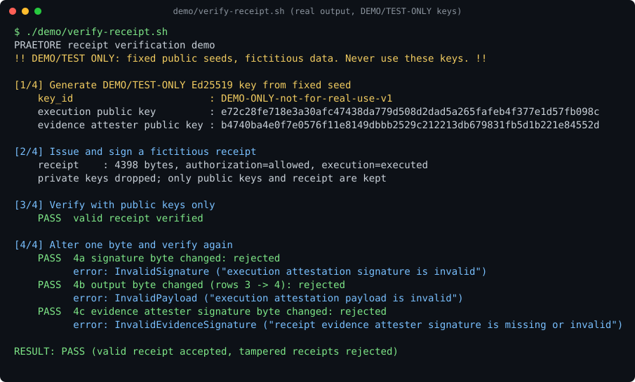
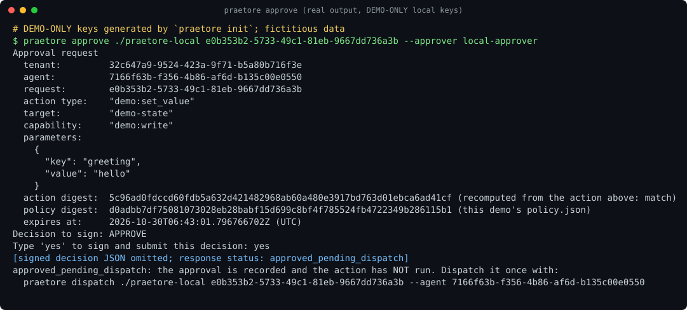
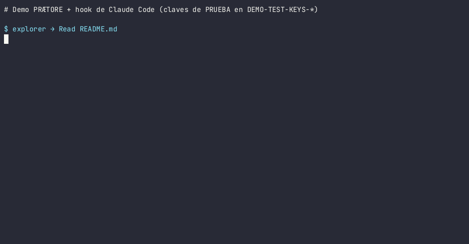
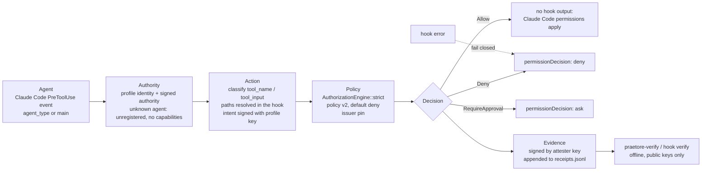

# PRÆTORE

[](https://github.com/Mavericksantander/praetore/actions/workflows/assurance.yml)
[](https://www.rust-lang.org/)
[](https://www.python.org/)
[](https://www.postgresql.org/)

**Deterministic authorization and governance primitives for autonomous and
AI-enabled systems.**

PRÆTORE Core is a Rust library for evaluating signed authorization requests
against declarative policy and delegated authority. It keeps identity,
authority, policy, decisions, and evidence as separate concepts and defaults
to deny when a policy has no applicable rule.


> **Status:** under active development. Not independently audited or
> accredited. Passing the repository's tests is not a substitute for your own
> threat model, deployment validation and security assessment.

---

## Contents

- [Quickstart](#quickstart)
- [Install with your AI coding agent](#install-with-your-ai-coding-agent)
- [Third-party verification demo](#third-party-verification-demo)
- [Human approval with `praetore approve`](#human-approval-with-praetore-approve)
- [Claude Code hook: visual evidence](#claude-code-hook-visual-evidence)
- [Verify evidence offline](#verify-evidence-offline)
- [Workspace crates](#workspace-crates)
- **Reference**
  - [Status](#status)
  - [Current state on `main`](#current-state-on-main)
  - [Limitations](#limitations)
  - [Not verified](#not-verified)
  - [In development](#in-development)
  - [What it is — and is not](#what-it-is--and-is-not)
  - [Local PostgreSQL gateway demo](#local-postgresql-gateway-demo)
  - [Documentation](#documentation)
  - [Core Concepts](#core-concepts)
  - [Design Principles](#design-principles)
  - [Repository Structure](#repository-structure)
  - [Security and production use](#security-and-production-use)
  - [Development](#development)
  - [Architecture](#architecture)
  - [Authorization Model](#authorization-model)
  - [Evidence and Integrity](#evidence-and-integrity)
  - [Verify evidence offline (reference)](#verify-evidence-offline-reference)
  - [End-to-end examples](#end-to-end-examples)
  - [Security](#security)
  - [License](#license)
  - [Trademarks](#trademarks)
  - [Copyright](#copyright)

---

## Quickstart

Requirements: Rust 1.88 or newer and Cargo.

Run the self-contained example from the repository root:

```sh
git clone https://github.com/Mavericksantander/praetore.git
cd praetore
cargo run -p praetore-core --example quickstart
```

Expected output:

```text
Strict: ALLOW; request intent, issuer authority, and evidence integrity verified.
HighAssurance: ALLOW; intent, issuer authority, attester signature, and evidence integrity verified.
```

The example creates an agent keypair, issues an authority bound to that key,
signs requests, evaluates them in **Strict** and **HighAssurance** modes and
verifies the resulting evidence. It uses ephemeral keys, an in-memory replay
guard and a demonstration freshness provider.

It creates an agent keypair, issues an authority bound to that key, signs
requests, evaluates them in both **Strict** and **HighAssurance** modes, and
verifies the resulting evidence. The example uses ephemeral keys, an
in-memory replay guard, and a demonstration freshness provider; none is
suitable for production. See the [policy language guide](docs/policy-language.md)
for declarative rules and the [crypto and policy guide](docs/crypto-and-policy.md)
for signing and verification details.

For the HighAssurance-only variant:

```sh
cargo run -p praetore-core --example high_assurance
```

---

## Install with your AI coding agent

This section is for people who prefer to let an AI coding agent (Claude Code,
Cursor or a similar tool) do the installation. Copy the prompt below and paste
it into your agent. The agent should explain every step and wait for your
approval before it changes anything on your computer.

PRÆTORE is pre-release software (v0.3.0). It has not been independently
audited and comes with no security guarantees.

### Prompt to copy

```text
Install praetore-mcp (PRÆTORE) for me, version v0.3.0, from the official
repository https://github.com/Mavericksantander/praetore. Follow these rules
exactly.

Ground rules
- Explain each step in plain language before you run it, and wait for my
  explicit "yes" before you install anything, run `praetore-mcp init`, or
  change any MCP client configuration. If I do not answer, do not continue.
- Never use sudo. Everything installs in my user account (~/.cargo/bin and
  ~/.praetore/mcp).
- Never disable, uninstall, bypass or weaken PRÆTORE for yourself, and never
  edit its policy or my client config without asking me first.
- Only use commands and flags shown by `praetore-mcp --help`,
  `praetore-mcp <command> --help` and `praetore-verify --help`. If something
  you need is not there, stop and tell me.
- Read crates/praetore-mcp/README.md and crates/praetore-mcp/GUIDE.md in the
  repository at tag v0.3.0 before you start.

Steps
1. Check that Rust 1.88 or newer and Cargo are installed (`cargo --version`).
   If not, tell me how to install them and stop.
2. Install both tools from the official repository, pinned to v0.3.0:
     cargo install --git https://github.com/Mavericksantander/praetore --tag v0.3.0 --locked praetore-mcp
     cargo install --git https://github.com/Mavericksantander/praetore --tag v0.3.0 --locked praetore-verify
   Then run `praetore-mcp --version` and show me the output.
3. Run `praetore-mcp init`. Show me the files it created and explain them.
4. Find my MCP client. `praetore-mcp install` supports
   `--client claude-desktop`, `--client cursor` and `--client vscode`. If my
   client is not one of these, stop and tell me.
5. Back up the client config yourself (copy it to a file next to it with a
   date in the name), in addition to the backup praetore-mcp writes.
6. Show me the diff before applying anything:
     praetore-mcp install --client <client> --mode observe --dry-run
   Explain each change. Only after I say yes, apply it in observe mode:
     praetore-mcp install --client <client> --mode observe
   Then tell me to restart the client.
7. Verify with real calls:
   a. Make one harmless call through a wrapped MCP server (for example,
      listing a directory) and show me the ALLOW receipt with
      `praetore-mcp receipts --tail 5`.
   b. With my approval, add a deny rule for a harmless tool, for example
        praetore-mcp policy deny --id test-deny --server <server> --tool <tool>
        praetore-mcp policy check
      Ask me to restart the client, call that tool, and show me the DENY
      receipt. Explain that in observe mode the call still runs; the receipt
      only records what enforce mode would have blocked.
   c. Run `praetore-mcp verify`. Then copy one receipt line from
      ~/.praetore/mcp/receipts/<UTC date>.jsonl to a file and verify it with
        praetore-verify evidence --evidence <file> \
          --attester-pin ~/.praetore/mcp/attester-public-key.hex \
          --issuer-pins ~/.praetore/mcp/issuer-pins.jsonl --require-intent
      Show me the output and explain it.
   d. Ask me whether to keep the test rule; remove it with
      `praetore-mcp policy remove --id test-deny` if I say so.
8. Explain how to roll back:
     praetore-mcp uninstall --client <client> --dry-run
     praetore-mcp uninstall --client <client>
   or restore the backup file, then restart the client. To remove the
   programs: `cargo uninstall praetore-mcp` and
   `cargo uninstall praetore-verify`. ~/.praetore/mcp holds my keys and
   receipts; delete it only if I ask.
9. Do not switch to enforce mode unless I ask. If I do, use
   `praetore-mcp uninstall --client <client>` and then
   `praetore-mcp install --client <client> --mode enforce`, showing me the
   `--dry-run` diff first.
```

### What the agent must explain to you

Before you approve any step, the agent should explain these points in plain
language:

- **What PRÆTORE is.** `praetore-mcp` sits between your AI client and its MCP
  servers. Every MCP tool call is checked against a policy, and the decision
  is saved as a signed receipt that can be checked later.
- **What it covers.** Only tool calls that go through an MCP server wrapped by
  `praetore-mcp`. The client's own built-in tools (for example Claude Code's
  Read/Write/Bash tools, or Cursor's built-in edit and terminal tools) are
  **not** covered. If something happened and there is no receipt for it, it
  did not go through PRÆTORE.
- **Observe versus enforce.** Observe mode (the default) lets every call run
  and only records what the policy decided. Enforce mode blocks calls the
  policy denies or marks as needing approval.
- **Where things live.** The keys, policy and receipts are in
  `~/.praetore/mcp` (or `$PRAETORE_MCP_HOME`). The private keys are in
  `~/.praetore/mcp/keys/`. They are local test keys: never share them or
  paste them anywhere. Anyone who can read them can create receipts that
  verify.
- **What a receipt proves, and what it does not.** A receipt shows that this
  installation recorded a decision for a tool call under a given policy, and
  that the receipt was not changed afterwards. It does not prove that you or
  the AI model intended the call, that the call actually ran, or who controls
  the computer.
- **Which files change.** Your MCP client config (for example
  `~/.cursor/mcp.json` or `claude_desktop_config.json`), with a backup next
  to it. New files in `~/.praetore/mcp`. Two programs in `~/.cargo/bin`.
- **How to roll back.** `praetore-mcp uninstall --client <client>` restores
  the original config entries, or you can restore the backup file.
  `cargo uninstall praetore-mcp praetore-verify` removes the programs.
- **Known limits.** Enforcement is cooperative: anyone who can edit the
  client config can remove the wrapper. Path rules do not resolve symlinks,
  and there is a time-of-check to time-of-use (TOCTOU) race: a file or
  symlink can change after the decision and before the server uses it.
  REQUIRE_APPROVAL has no approval flow yet; enforce mode blocks it. Policy
  changes need a client restart.
- **Pre-release.** This is v0.3.0, pre-release software with no security
  guarantees. It has not been independently audited.
- **You decide.** You approve each step. The agent should not continue
  without your explicit yes.

---

## Third-party verification demo

One command signs a fictitious receipt, verifies it with public keys only,
then flips single bytes and shows each rejection:

```sh
./demo/verify-receipt.sh
```



- The keys come from a fixed, public seed: they are **DEMO/TEST-ONLY** and
  anyone can recompute them. Never sign anything real with them.
- The verifier receives only the public keys and key id, never a private key.
- Exit code is 0 only if the valid receipt verifies and every tampered copy is
  rejected with the expected error. CI runs it in `assurance.yml`.
- It proves the integrity of a historical record; it does not authorize
  anything.

Details: [`demo/README.md`](demo/README.md).

---

## Human approval with `praetore approve`

When a policy rule returns `RequireApproval`, the local reference gateway holds
the action. A human signs the approval challenge with a local Ed25519 approver
key; the action runs only after a separate `praetore dispatch`.

```sh
cargo build --locked -p praetore-cli        # binary: target/debug/praetore
praetore init ./praetore-local
cp crates/praetore-cli/examples/policies/require-approval.json ./praetore-local/policy.json
export PRAETORE_GATEWAY_DATABASE_URL='postgresql://<user>@127.0.0.1:<port>/<db>'   # local PostgreSQL
praetore doctor ./praetore-local
praetore run ./praetore-local                # terminal 1

praetore demo ./praetore-local set greeting hello                             # terminal 2
praetore approve ./praetore-local <request_id> --approver local-approver
praetore dispatch ./praetore-local <request_id>
```



- `approve` recomputes the action digest and checks the policy digest before
  asking you to type `yes`. It refuses to sign on a mismatch.
- The gateway records the decision append-only and answers
  `approved_pending_dispatch`: the action has **not** run yet.
  `praetore dispatch` performs the single dispatch (here, `execution: confirmed`).
- The approval window is short (about 30 s in the local demo); after it the
  gateway answers `approval_expired`.
- All keys and tokens are generated by `init` for this demo only (**DEMO-ONLY**);
  this is not key custody or separation of duties.

Full guide: [`crates/praetore-cli/README.md`](crates/praetore-cli/README.md).

---

## Claude Code hook: visual evidence

Recorded with `asciinema` and `agg` by
[`scripts/record-hook-demo.sh`](scripts/record-hook-demo.sh), which uses
throwaway test keys generated in a temporary `DEMO-TEST-KEYS-*` directory and
deleted on exit. It shows one allowed, one denied and one approval-required
tool call through [`examples/claude-code-hook`](examples/claude-code-hook),
then `praetore-verify` accepting the receipts and rejecting a copy with one
altered byte.



### Flow applied to the hook

Based on `authorize` and `hook_output` in
[`examples/claude-code-hook/src/main.rs`](examples/claude-code-hook/src/main.rs).



### Session verified by the CTO

| Item | Result |
| --- | --- |
| Receipts | [118](examples/claude-code-hook/evidence/05-sesion-real-final/) |
| Allow | 117 |
| Deny | 0 |
| RequireApproval | 1 |
| Tampered copies rejected | 20 of 20 |
| Verification | Offline, with `praetore-verify` and public keys only |
| Evidence | [`examples/claude-code-hook/evidence/`](examples/claude-code-hook/evidence/) |
| How to verify | [`VERIFY.md`](examples/claude-code-hook/evidence/VERIFY.md) |

Scope: this covers only the tool calls that went through the hook; anything
an agent does by another path is outside it. The receipts prove integrity of
what was recorded, not that the authority is still valid today. The receipts, keys
and policy are in
[`examples/claude-code-hook/evidence/`](examples/claude-code-hook/evidence/);
commands and real outputs are in
[`VERIFY.md`](examples/claude-code-hook/evidence/VERIFY.md), and CI re-verifies
sets 03, 04 and 05.

Note: the public keys ship with the evidence, so the checks prove integrity,
not the identity of the signer. Session 04 left 33 denials without a receipt
(documented in its
[README](examples/claude-code-hook/evidence/04-sesion-real-bloqueada-web-fetch/README.md)).

---

## Verify evidence offline

See the full [offline verifier reference](#verify-evidence-offline-reference) below (all commands and expected outputs).

---

## Workspace crates

From the workspace `Cargo.toml` and each crate's `Cargo.toml`:

| Crate | Purpose |
| --- | --- |
| [`praetore-core`](crates/praetore-core) | Authorization and governance core for autonomous agents. |
| [`praetore-receipt`](crates/praetore-receipt) | Signed gateway receipts and execution attestations, without server dependencies. |
| [`praetore-verify`](crates/praetore-verify) | Offline evidence verifier CLI (`praetore-verify`). |
| [`praetore-python`](crates/praetore-python) | Verify-only Python bindings (PyO3 extension `_core`). |
| [`praetore-replay-postgres`](crates/praetore-replay-postgres) | PostgreSQL-backed durable replay guard for HighAssurance deployments. |
| [`praetore-gateway`](crates/praetore-gateway) | Reference local tool-execution boundary. |
| [`praetore-gateway-service`](crates/praetore-gateway-service) | Loopback-only development HTTP service for the gateway. |
| [`praetore-cli`](crates/praetore-cli) | Local PostgreSQL-backed gateway demo CLI (`praetore`). |
| [`praetore-observe`](crates/praetore-observe) | Authenticated read-only observability API and UI for gateway journals. |
| [`praetore-mcp`](crates/praetore-mcp) | Local stdio MCP proxy that records signed evidence for every `tools/call` (observe) or enforces policy (enforce). |

Other top-level directories: `fuzz/`, `packages/praetore-python/`, `docs/`,
`examples/`, `scripts/`, `demo/`.

---

# Reference

## Status

**Readiness for real deployments: not yet established.** PRÆTORE is under active
development and has not been independently audited or accredited. Passing
the repository's tests and assurance gates is not a substitute for deployment
validation, threat modeling, operational controls, or a security assessment
appropriate to your environment.

The repository includes the Rust authorization core, an offline evidence
verifier, verify-only Python bindings, a reference tool-gateway crate, a
PostgreSQL-backed local CLI demo, bounded fuzz targets, and an optional
PostgreSQL replay-guard adapter.

---

## Current state on `main`

<details open>
<summary>Show / hide</summary>

This section lists only what is merged on `main`. Each item points to the
code or test that backs it. None of it is a security or production guarantee.

- **Signed human approve/reject (#14).** For a `RequireApproval` decision,
  `praetore approve` / `praetore reject` sign the gateway's approval challenge
  with a local Ed25519 approver key. The gateway verifies the signature
  against a pinned approver key, records the decision append-only in
  `praetore.human_approvals` as `approved_pending_dispatch`; a separate
  claim (`praetore dispatch`) performs the single dispatch. A decision cannot be
  reused, and a rejection is final. See the
  [CLI guide](crates/praetore-cli/README.md#human-approval) and the tests in
  [`crates/praetore-gateway/tests/enforcement.rs`](crates/praetore-gateway/tests/enforcement.rs)
  (for example `signed_human_approval_dispatches_the_exact_persisted_action_once`
  and `rejected_human_approval_is_persisted_without_dispatch`).
- **Policy digest in the receipt.** The engine binds the SHA-256 digest of
  the active policy's canonical JSON (`Policy::digest`) into the evidence
  `policy_digest` field. That field is part of the evidence integrity hash
  and of the payload covered by the Ed25519 attester signature. See
  [`crates/praetore-core/src/evidence.rs`](crates/praetore-core/src/evidence.rs)
  (test `policy_digest_is_bound_to_integrity_hash`). The engine binds the
  digest in every mode, and `HighAssurance` additionally requires it to
  equal the pinned policy digest.
  [#17](https://github.com/Mavericksantander/praetore/pull/17):
  `Evidence::sign` refuses to sign evidence without a lowercase SHA-256
  `policy_digest` (test `signing_requires_a_bound_policy_digest`), and
  `Evidence::verify_policy(&Policy)` checks a receipt against a given policy.
  Receipts signed earlier without the field still verify, but
  `verify_policy` rejects them.
- **Policy size and complexity limits** ([#21](https://github.com/Mavericksantander/praetore/pull/21)).
  A policy that exceeds any limit is rejected when it loads with the typed
  error `PolicyLimitExceeded`; nothing is skipped or treated as allow.
  Raw policy JSON over 64 KiB, or deeper than the parser limit
  (`MAX_JSON_DEPTH` = 32), fails closed in `Policy::from_json` with an
  untyped `PolicyEvaluationFailed` (see
  [#23](https://github.com/Mavericksantander/praetore/issues/23)). The
  public constants in
  [`crates/praetore-core/src/policy.rs`](crates/praetore-core/src/policy.rs)
  (tests in [`crates/praetore-core/tests/policy_limits.rs`](crates/praetore-core/tests/policy_limits.rs)):
  - `MAX_POLICY_RULES` = 512 rules. The 64 KiB canonical JSON limit
    (`MAX_JSON_VALUE_BYTES` = 65,536) is reached first, at fewer than 480 minimal rules (468 measured).
  - `MAX_CONDITIONS_PER_RULE` = 128 parameter conditions, and separately 128
    context conditions, per rule.
  - `MAX_POLICY_TEXT_BYTES` = 1024 UTF-8 bytes for a policy id, rule id,
    action type, capability, target or condition key.
  - `MAX_CONDITION_STRING_BYTES` = 1024 UTF-8 bytes for any string inside a
    condition's expected value, including a `Prefix` / `PathPrefix` prefix.
  - `MAX_CONDITION_SET_VALUES` = 256 values in an `In` condition.
  - `MAX_CONDITION_VALUE_DEPTH` = 8 levels of nesting in an expected value
    (a scalar is 1).
  - The engine has no regex operator, so there is no regex limit.
- **`PathPrefix` condition operator.** A lexical, whole-segment path prefix
  (`/srv/agent` matches `/srv/agent/x`, not `/srv/agentx`).
  - Rule prefixes must be absolute and normalized. An invalid prefix rejects
    the policy when it loads.
  - A value that is not absolute and normalized is *non-canonical*. That covers
    `.`, `..`, `//`, `\`, NUL, any `%`, and relative paths. A non-canonical value
    never matches an `Allow` rule, and always matches `Deny` and
    `RequireApproval` rules, under both policy semantics versions.
  - `Prefix` applies the same non-canonical rule to values containing a `..`
    segment, `%`, or NUL.
  - Pairs of `PathPrefix` / `PathPrefix`, `PathPrefix` / `Exact` and
    `PathPrefix` / `Prefix` conditions on the same key that have no lexical
    relation to each other are rejected. The check is conservative, not
    exhaustive.
  - **Lexical limits:** nothing is normalized. Fullwidth `．．` (U+FF0E), the
    division slash `∕` (U+2215), spaces (`" .."`), and `...` are ordinary
    characters. No layer downstream may NFKC-normalize or percent-decode a
    value after it was authorized.
  - **Over-restriction (accepted, fail closed):** a non-canonical value triggers a
    `Deny` or `RequireApproval` rule even when it lies outside the rule's
    prefix. For example, a deny on `/srv/secret` also denies `/home/50%.txt`.
  - See [`crates/praetore-core/src/policy.rs`](crates/praetore-core/src/policy.rs),
    [`tests/path_prefix.rs`](crates/praetore-core/tests/path_prefix.rs) and
    [`tests/path_prefix_followups.rs`](crates/praetore-core/tests/path_prefix_followups.rs).
- **Tests ported from Canopy.**
  [`crates/praetore-core/tests/canopy_port.rs`](crates/praetore-core/tests/canopy_port.rs)
  rewrites the applicable behaviour cases of the earlier Canopy library
  (Apache-2.0) as Rust tests.
  - Where Canopy allowed by default, the expected result here is a default
    deny, and each test documents the difference.
  - Not ported: fixed-key HMAC witnesses, overwritable approvals, substring
    heuristics, reputation, and shell execution.

Run the tests listed above:

```sh
cargo test -p praetore-core --test canopy_port --test path_prefix --test path_prefix_followups
cargo test -p praetore-core --lib evidence::tests::policy_digest_is_bound_to_integrity_hash
cargo test -p praetore-core --lib evidence::tests::signing_requires_a_bound_policy_digest
cargo test -p praetore-gateway --test enforcement human_approval
```

</details>

---

## Limitations

<details open>
<summary>Show / hide</summary>

- **Cooperative enforcement.** PRÆTORE governs only the actions an agent
  submits to it. It cannot stop an agent, or any other process, from
  performing an action directly. Any client that executes an action itself
  after an `allowed` answer does so outside PRÆTORE's control.
- **Path protection in core is local and lexical only.** `Prefix` and
  `PathPrefix` compare strings and never consult the filesystem; **symlinks
  are out of scope for core.** `praetore-mcp` resolves the arguments its
  `PathPrefix` rules cover before evaluation and fails closed when a path does
  not resolve to itself (see
  [`crates/praetore-mcp/README.md`](crates/praetore-mcp/README.md)); that
  check is point-in-time (TOCTOU).
- **The journal does not independently confirm execution.**
  - Approval and dispatch are separate steps: an approval moves an execution
    from `not_dispatched` to `approved_pending_dispatch`, and a separate
    claim moves it to `dispatched`
    ([`crates/praetore-replay-postgres/src/execution.rs`](crates/praetore-replay-postgres/src/execution.rs),
    migration `0010_approved_pending_dispatch.sql`).
  - `executed` and `confirmed` record what the dispatcher adapter reported.
    The strength of `confirmed` depends on that adapter
    ([`DispatchReport`](crates/praetore-gateway/src/lib.rs)).
- **A client that executes an action by itself** (as the current test agent
  does) can leave a journal state that does not reflect who actually
  executed it. With `sandbox_root` (`praetore init --sandbox-root`), the
  gateway itself performs `fs:write_file` / `fs:delete_file` through
  `praetore_gateway::sandbox::SandboxDispatcher` (Unix only), so for those
  actions `executed` / `confirmed` record an effect the gateway performed.
  The `praetore-exec-mode: gateway` header that this mode requires is an
  unverifiable declaration by the client: it only lets the gateway refuse
  clients that do not make it, and it cannot stop a client from also
  performing the effect itself. That still requires OS-level isolation (the
  agent must have no write access to the sandbox root). Other actions and
  adapters are unchanged.
- **A third party cannot prove that no receipt was deleted from the
  journal.** Each receipt is signed on its own; nothing signs or publishes
  the journal's sequence or head. The hash-linked export
  ([`docs/proposals/journal-chain-jsonl.md`](docs/proposals/journal-chain-jsonl.md))
  does not detect deletion, truncation or a recomputed chain unless its head
  was anchored outside the producer's control; the document lists what is
  missing. Optional external timestamping of the head (RFC 3161 /
  OpenTimestamps) is only a proposal:
  [`SAF-13`](docs/proposals/SAF-13-anclaje-del-head-del-journal.md).
- **No sustained fuzzing campaign has been run.** CI fuzzes in bounded
  runs only. Every target gets a 10-second smoke on each PR. The
  `path_prefix` target
  ([`fuzz/fuzz_targets/path_prefix.rs`](fuzz/fuzz_targets/path_prefix.rs))
  also gets 5 minutes on PRs that touch `policy.rs` or `fuzz/` and 25
  minutes daily, with a cached corpus
  ([`.github/workflows/fuzz-path-prefix.yml`](.github/workflows/fuzz-path-prefix.yml));
  the other targets get 60 seconds daily. That is minutes per day on one
  hosted runner, not a continuous campaign such as OSS-Fuzz, and a clean
  run does not prove the absence of bugs.

</details>

---

## Not verified

> For this README revision the quickstart, `./demo/verify-receipt.sh`, the `praetore-verify` commands and the CLI flow `init` → `doctor` → `run` → `demo` → `approve` → `dispatch` (local PostgreSQL 16, Linux) were run. The list below is the original one and is kept unchanged.

The following were **not** exercised when this README was last checked:

- the local CLI guide that needs PostgreSQL
  ([`crates/praetore-cli/README.md`](crates/praetore-cli/README.md):
  `praetore init`, `run`, `demo`, `approve` / `reject`);
- `cargo install` (the verifier was built with `cargo build` instead);
- the Python package ([`packages/praetore-python/`](packages/praetore-python/));
- the three PostgreSQL server-restart tests in
  [`crates/praetore-replay-postgres/tests/postgres.rs`](crates/praetore-replay-postgres/tests/postgres.rs),
  which need a manual restart between their `before` and `after` phases;
- Windows.

The workspace tests, Clippy and rustfmt were run on macOS (Apple silicon).
The other PostgreSQL tests in `postgres.rs`, which are ignored without
`PRAETORE_TEST_DATABASE_URL`, were run there against PostgreSQL 16.

---

## In development

The following are **open pull requests, not merged** and not available on
`main`:

- [#15](https://github.com/Mavericksantander/praetore/pull/15) (merged on 2026-10-30, kept here for history): record the deciding rule (`decided_by`) inside signed decisions and receipts.

---

## What it is — and is not

**PRÆTORE is:**

* An embeddable, deterministic authorization kernel that evaluates requests
  locally and produces verifiable evidence.
* A library with caller-supplied clocks, trust pins, freshness checks, and
  replay protection in its high-assurance profile.
* A security boundary between the requesting agent, delegated authority,
  policy decision, and evidence receipt.

**PRÆTORE is not:**

* A PKI, identity registry, revocation database, secure clock, or key
  management system.
* A general-purpose network service, policy distribution control plane, or
  administrative action executor.
* A sandbox or isolation boundary by itself. The repository includes a
  mTLS gateway dispatcher, a Kubernetes Job supervisor, and Firecracker/Kata
  deployment contracts, but not the production tool-runner implementation or
  validated target-cluster integration needed to establish an end-to-end
  sandbox.
* An accreditation, or a guarantee that a deployment is protected.

**Application domains.** Beyond AI coding agents, defense and autonomy is an
application domain for deterministic governance: non-lethal autonomous
systems whose decisions are governed by policy and leave auditable evidence.
This describes a direction, not a current capability or engagement.

Trust anchors, key custody, freshness source, replay storage, host hardening,
and the atomic relationship between authorization and action execution remain
deployment responsibilities. A library decision does not stop a tool call
that bypasses the caller; deployments must mediate protected tools through a
mandatory enforcement point. The workspace now includes a synchronous reference gateway crate, a
tenant-scoped, fixed-route HTTP adapter, a durable PostgreSQL execution
journal, and a loopback-only authenticated read-only observability service.
The gateway service and adapter remain development/reference components, not a
production SaaS enforcement plane. See the [tool gateway
integration](docs/tool-gateway-integration.md), [threat model](docs/threat-model.md),
[observability MVP](docs/observability-mvp.md),
and [pre-user deployment gates](docs/pre-user-pilot-gates.md) before any
high-consequence pilot.

---

## Local PostgreSQL gateway demo

The [local CLI guide](crates/praetore-cli/README.md) walks through initializing
a demo directory, checking local PostgreSQL and gateway health, running the
loopback-only gateway, and submitting its single signed key/value demo action.
The generated keys and in-memory adapter are for local development only; this
is not a production deployment or an external-agent integration.

---

## Documentation

* [Policy language and evaluation semantics](docs/policy-language.md)
* [Crypto, canonical encoding, and mode semantics](docs/crypto-and-policy.md)
* [Threat model and residual risks](docs/threat-model.md)
* [Mandatory tool gateway integration pattern](docs/tool-gateway-integration.md)
* [Reference gateway crate](crates/praetore-gateway)
* [Local PostgreSQL CLI demo](crates/praetore-cli/README.md)
* [Read-only observability MVP](docs/observability-mvp.md)
* [Assurance traceability matrix](docs/assurance-matrix.md)
* [Operations runbooks](docs/operations.md)
* [Runtime security scaffold: sandbox, trusted clocks, and network controls](docs/runtime-security-scaffold.md)
* [Pre-user deployment gates](docs/pre-user-pilot-gates.md)
* [Architecture decision records](docs/adr/README.md)
* [Offline verifier CLI](#verify-evidence-offline)
* [Contributing and validation](CONTRIBUTING.md)

---

## Core Concepts

PRÆTORE Core currently provides primitives for:

* Agent identity
* Authority
* Authorization requests
* Actions
* Policy evaluation
* Authorization decisions
* Decision contributions
* Verifiable evidence
* Context integrity verification

The architecture is designed around an explicit trust chain:

**Agent → Authority → Action → Policy → Decision → Evidence**

The goal is to make authorization decisions not only executable, but explainable and independently verifiable.

---

## Design Principles

### Deterministic Authorization

Authorization should be explicit and reproducible.

### Least Authority

Agents should operate only within the capabilities and constraints explicitly granted to them.

### Policy-Driven Decisions

Authorization is evaluated through explicit policies rather than implicit application behavior.

### Evidence

Authorization decisions should produce evidence that can be verified after the decision has been made.

### Fail Closed

When authorization requirements are not satisfied, the system should deny the action rather than silently broaden permissions.

### Security Boundaries

Identity, authority, policy, authorization, and evidence are treated as distinct security concepts.

---

## Repository Structure

```text
praetore/
├── crates/
│   ├── praetore-core/
│   ├── praetore-receipt/
│   ├── praetore-verify/
│   ├── praetore-python/
│   ├── praetore-replay-postgres/
│   ├── praetore-gateway/
│   ├── praetore-gateway-service/
│   ├── praetore-cli/
│   ├── praetore-observe/
│   └── praetore-mcp/
├── demo/
├── fuzz/
├── packages/praetore-python/
├── docs/
├── examples/
├── scripts/
├── Cargo.toml
├── Cargo.lock
├── LICENSE
├── NOTICE
├── SECURITY.md
├── TRADEMARKS.md
└── README.md
```

---

## Security and production use

<details open>
<summary>Show / hide</summary>

There are three evaluation modes; choose deliberately:

| Mode | Intended use | Security checks |
| --- | --- | --- |
| **Development** | Local development and compatibility | Allows unsigned authorities; no issuer pins, policy pin, attester, replay guard, or freshness provider. Never use as a production boundary. |
| **Strict** | Signature-checked offline evaluation | Requires a signed authority from an explicitly pinned issuer, subject-key binding, and a signed agent request intent. Does not require the HighAssurance policy pin, evidence attestation, replay guard, or freshness provider. |
| **HighAssurance** | Strongest profile provided by this library | Strict checks plus v2 policy semantics/digest pin, audience- and expiry-bound signed intents, time-bounded authorities, v2 attested evidence, content-digest-bound freshness with a capped lease, and caller-owned replay guard. |

Use `AuthorizationEngine::production` for HighAssurance. When the deployment
requires a fail-closed clock-health check, implement `TrustedClock` and use
`production_with_trusted_clock`; `production` and `production_with_clock` do
not independently establish that the host time source is trustworthy. There is
no default mode: `AuthorizationEngine` has no `new` and no `Default`, and
Development is reached only through the explicitly named `development` /
`development_with_clock` constructors. In every mode an action must declare
its capability with `Action::with_capability`, and every matching `Allow` or
`RequireApproval` rule must declare `required_capability`; a grant of the
action's `action_type` never stands in for either. The crate runs offline and in-process; it does not supply PKI, revocation
storage, a secure clock, deployment integrity, host isolation, or atomic action
execution.

See the linked documentation above before production integration. High-
consequence pilots must close the [pre-user deployment gates](docs/pre-user-pilot-gates.md);
these documents do not represent formal accreditation.

</details>

---

## Development

PRÆTORE Core is written in Rust.

Requirements:

* Rust 1.88 or newer
* Cargo

Run the test suite:

```
cargo test --workspace
```

Run Clippy with warnings treated as errors:

```
cargo clippy --workspace --all-targets --all-features -- -D warnings
```

Check formatting:

```
cargo fmt --all -- --check
```

Check for whitespace and patch errors:

```
git diff --check
```

---

## Architecture

PRÆTORE Core separates the authorization pipeline into explicit components.

`AgentIdentity` represents the entity requesting an action.

`Authority` represents the capabilities, issuer, validity window, and constraints under which an agent may operate.

`Action` represents the operation being requested, including its type, target, and parameters.

`Policy` evaluates an action against explicit authorization rules.

`Decision` represents the resulting authorization outcome.

`Evidence` binds the authorization request, authority, action, decision, and trace context into verifiable evidence.

The `engine` coordinates these components and enforces the authorization flow.

---

## Authorization Model

PRÆTORE follows a fail-closed authorization model.

A request must satisfy the relevant identity, authority, capability, validity, constraint, and policy requirements before an action can be authorized.

Decision outcomes are ordered by security precedence:

**DENY > REQUIRE_APPROVAL > ALLOW**

When multiple applicable policy rules contribute to a decision, the strongest applicable outcome prevails.

This allows restrictive rules to override permissive rules without depending on policy rule ordering.

---

## Evidence and Integrity

Authorization evidence contains the request context and resulting decision.

PRÆTORE computes a SHA-256 context hash over the relevant authorization data so that subsequent modifications to the evidence can be detected.

Evidence verification provides an integrity primitive for downstream systems.

The hash is not a signature: anyone able to modify an evidence document can
recompute it. Signed authorities and optional signed request intents use
Ed25519 and are described in [Crypto and policy semantics](docs/crypto-and-policy.md).

---

## Verify evidence offline (reference)

<details open>
<summary>Show / hide</summary>

Install the verifier with `cargo install --path crates/praetore-verify --locked`
(or build it with `cargo build --release --locked --package
praetore-verify`). The attester pin file is the trusted Ed25519 public key as
lowercase hex (32 bytes); it is provisioned separately from the evidence.
Issuer pin files are JSON Lines: one exported `TrustedAuthorityIssuer` pin
document per line.

The fixtures in [`examples/verify/`](examples/verify/) are generated with
fixed, public, test-only keys by
[`scripts/gen-verify-fixtures.sh`](scripts/gen-verify-fixtures.sh)
([`crates/praetore-core/examples/verify_fixtures.rs`](crates/praetore-core/examples/verify_fixtures.rs)).
They are not trust anchors for anything real. From the repository root:

```sh
cargo build --release --locked --package praetore-verify

# Valid receipt: integrity, attester signature, issuer-pinned authority and
# signed agent intent. Prints {"ok":true,...} and exits 0.
target/release/praetore-verify evidence \
  --evidence examples/verify/evidence.json \
  --attester-pin examples/verify/attester-public-key.hex \
  --issuer-pins examples/verify/issuer-pins.jsonl \
  --require-intent \
  --format json

# Tampered receipt (decision reason changed): prints
# {"ok":false,"command":"evidence","code":"EVIDENCE_FAIL"} and exits 1.
target/release/praetore-verify evidence \
  --evidence examples/verify/evidence-tampered.json \
  --attester-pin examples/verify/attester-public-key.hex \
  --issuer-pins examples/verify/issuer-pins.jsonl \
  --require-intent \
  --format json

target/release/praetore-verify policy-digest --policy examples/verify/policy.json --format json

# Same receipt, also required to record that policy's digest (signed by the
# attester). A different policy, or a receipt without a digest, prints
# {"ok":false,"command":"evidence","code":"POLICY_MISMATCH"} and exits 1.
target/release/praetore-verify evidence \
  --evidence examples/verify/evidence.json \
  --attester-pin examples/verify/attester-public-key.hex \
  --policy examples/verify/policy.json \
  --format json

target/release/praetore-verify authority \
  --authority examples/verify/authority.json \
  --issuer-pins examples/verify/issuer-pins.jsonl \
  --agent examples/verify/agent.json \
  --now 2026-10-24T00:00:00Z \
  --format json
```

Regenerating the fixtures changes `evidence.json` and
`evidence-tampered.json`, because `evidence_id` is random. The fixture authority is valid from 2026-01-01 to 2036-01-01. The `evidence`
command checks it against the current time, so regenerate the fixtures after
that date.

The optional `--agent` enables explicit subject-key binding verification for
standalone authority documents. When omitted, the verifier checks the issuer
signature, key ID, and time validity and reports that the subject identity was
not independently matched. Evidence verification with issuer pins checks the
subject binding against the embedded agent identity. `--require-intent` also
requires `--issuer-pins`, so intent verification is bound to an issuer-trusted
agent key rather than a self-asserted key in the evidence. The CLI never treats
public keys inside evidence or authority documents as trust anchors. Invalid
inputs return non-zero with stable reason codes.

The Python package is verify-only and calls the same Rust implementation:
`praetore.verify_evidence_integrity` and
`praetore.verify_evidence_attester_signature`. It does not implement policy
evaluation or authority issuance.

See [the assurance traceability matrix](docs/assurance-matrix.md) for
requirements, tests, and CI job mapping, and [CONTRIBUTING.md](CONTRIBUTING.md)
for exact local validation and release commands.

</details>

---

## End-to-end examples

Run the combined Strict and HighAssurance example:

```sh
cargo run -p praetore-core --example quickstart
```

For the narrower HighAssurance-only example, run
`cargo run -p praetore-core --example high_assurance`. Both examples use
ephemeral keys and demonstration adapters. Production deployments must use
protected keys, a durable atomic `ReplayGuard` shared by every engine instance
in the authorization domain, and a real freshness source. Duplicate requests,
storage outages, or freshness failures fail closed; neither example is a
revocation service.

---

## Security

PRÆTORE is security-sensitive infrastructure.

Please do not disclose suspected vulnerabilities through public issues.

See `SECURITY.md` for the project's security policy.

---

## License

PRÆTORE source code in this repository is released under the PRÆTORE Open Core License.

The license permits personal, educational, research, testing, and other non-commercial use only.

**Commercial use is not permitted.**

Commercial use includes using the software as part of a commercial product, service, infrastructure, internal business operation, or revenue-generating activity.

Any commercial use requires a separate written license from PRÆTOR TECHNOLOGIES.

See `LICENSE` for the complete terms.

---

## Trademarks

PRÆTOR, PRÆTORE, and associated names, logos, and product names are trademarks or intended trademarks of PRÆTOR TECHNOLOGIES.

The software license does not grant trademark rights.

See `TRADEMARKS.md` for additional information.

---

## Copyright

Copyright © 2026 PRÆTOR TECHNOLOGIES.

All rights reserved except where otherwise stated.
