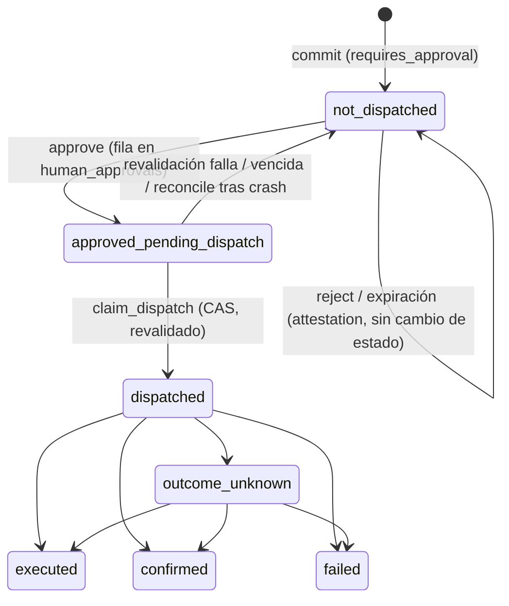

# Estado `approved_pending_dispatch` en el journal (propuesta)

Estado: **implementada** en #33 (migración `0010_approved_pending_dispatch.sql`). Se conserva como registro de diseño; el código vigente manda sobre este texto. La re-verificación de la aprobación en `claim_dispatch` y la migración 0012 llegaron después (#41, #42).
Propuesta original: solo documento. Base: `origin/main` `21f8141`.
Las referencias `archivo:línea` son contra ese commit.

## 1. Problema

Hoy una aprobación humana se registra y, **en la misma transacción**, la fila pasa a `dispatched`, antes de invocar al adaptador:

- `PostgresExecutionJournal::record_human_approval` (`crates/praetore-replay-postgres/src/execution.rs:251-360`) hace `INSERT INTO praetore.human_approvals` y, si `outcome = Approve`, `UPDATE … SET execution_status = 'dispatched' … AND execution_status = 'not_dispatched'` (`:342-356`).
- `Gateway::resolve_human_approval` (`crates/praetore-gateway/src/lib.rs:1080-1160`) llama a `record_human_approval` (`:1121`). Después vuelve a correr `validate_evidence_for_dispatch` (`:1129`) y recién entonces llama a `dispatcher.dispatch` (`:1133`) y a `record_terminal_attested` (`:1148`).
- El trigger vigente `validate_execution_journal_transition` (`migrations/0007_tenant_scoped_execution.sql:140-187`) permite `not_dispatched → dispatched` si existe una fila `approve` en `human_approvals`.

Entre el commit de la aprobación y la llamada al adaptador, la fila dice `dispatched`, pero `ExecutionStatus::Dispatched` está documentado como "el gateway se comprometió durablemente a invocar el adaptador" (`lib.rs:104-105`). Hay tres casos concretos:

1. **Crash entre ambos pasos.** La fila queda en `dispatched` sin que el adaptador haya recibido nada. `Gateway::reconcile` (`lib.rs:1390-1450`) trata `Dispatched` como "en vuelo" y pregunta a `dispatcher.reconcile`. La implementación por defecto de `ActionDispatcher::reconcile` devuelve `Unknown` (`lib.rs:884-896`), y la fila termina en `outcome_unknown`. Es honesto pero pierde información: se sabe que **no** se despachó y el journal no puede decirlo. `SandboxActionDispatcher::reconcile` (`crates/praetore-gateway-service/src/sandbox_dispatcher.rs:166-`) sí puede responder `NotApplied` (→ `failed`), pero solo si el supervisor está disponible.
2. **Vencimiento después de aprobar.** `record_human_approval` rechaza con `expires_at <= OffsetDateTime::now_utc()` (`execution.rs:306`). Ese es el reloj de pared del proceso, no el reloj del motor que usa SAF-10 (`Gateway::record_approval_expiration`, `lib.rs:1179-1193`). Si la ventana cierra entre el commit y la revalidación (`lib.rs:1129`), la fila pasa `dispatched → failed` (`lib.rs:1130`). Queda como un fallo de ejecución, cuando en realidad nunca se ejecutó. Tampoco hay `ApprovalExpiredReceipt`: es exclusivo con una decisión humana (`lib.rs:251-253`, trigger `enforce_approval_resolution_exclusive` en `0009`).
3. **Reintento.** Un segundo `resolve_human_approval` falla con `NotPending` (`lib.rs:1098-1103`), y un segundo INSERT viola `UNIQUE (tenant_id, agent_id, request_id)` → `ApprovalAlreadyRecorded`. No hay doble ejecución, pero tampoco hay forma legítima de completar un despacho que no ocurrió. El gateway nunca reintenta (`lib.rs:1279-1281`, `1384-1389`).

El camino `Allowed` no tiene este problema: `authorized` existe como estado previo (`mark_dispatched`, `execution.rs:222-249`). Y `reconcile` cierra `Authorized → NotDispatched` sin despachar (`lib.rs:1397-1416`). La propuesta da al camino `RequiresApproval` el equivalente.

`SandboxDispatcher` no existe con ese nombre; el tipo es `SandboxActionDispatcher`. Envía `Idempotency-Key: tenant:agent:request` (`sandbox_dispatcher.rs:150-155`), igual que `HttpActionDispatcher` (`http_dispatcher.rs:179`).

## 2. Máquina de estados propuesta

Hay un estado nuevo, `approved_pending_dispatch` (APD), solo para `authorization_status = 'requires_approval'`.

**Legales (nuevas):**
- `not_dispatched → approved_pending_dispatch`: solo si hay una fila `approve` y ningún evento previo con `to_status = 'approved_pending_dispatch'`.
- `approved_pending_dispatch → dispatched`: compare-and-set con `FOR UPDATE`. Es el único camino a `dispatched` para `requires_approval`.
- `approved_pending_dispatch → not_dispatched`: cierre sin despacho, con `ExecutionAttestation` de `NotDispatched`.

**Ilegales (el trigger las rechaza):**
- `not_dispatched → dispatched` para `requires_approval`. Hoy es legal y la propuesta la retira.
- Volver a APD desde cualquier estado, o entrar dos veces.
- APD con `authorization_status` `allowed` o `denied`.
- APD sin fila `approve`, o con una fila de `human_approval_expirations`.
- `approved_pending_dispatch` hacia `executed`, `confirmed`, `failed` u `outcome_unknown`. Sin pasar por `dispatched` no hay resultado posible.

## 3. Tipos de Rust

- `ExecutionStatus` (`lib.rs:108-116`) gana la variante `ApprovedPendingDispatch`. Su valor en la base es `approved_pending_dispatch`, mapeado en `execution_as_db` y `parse_execution` (`execution.rs:1043-1065`).
- `parse_record` (`execution.rs:912`) rechaza con `InvalidRecord` las combinaciones ilegales: APD con `authorization != RequiresApproval`, APD sin `human_approval` con `outcome = Approve`, y APD con `approval_expiration`.
- Typestate en el gateway, interno (no cambia `ActionDispatcher`):
  - `record_human_approval` con `Approve` devuelve un `ApprovedPendingDispatch { key, evidence, action_digest }`. No es `Clone`, y su constructor es privado del crate.
  - `journal.claim_dispatch(ApprovedPendingDispatch) -> Result<DispatchPermit, JournalError>` lo consume. `DispatchPermit` tampoco es `Clone`.
  - La llamada a `dispatcher.dispatch` queda detrás de una función que exige `DispatchPermit` por valor.
  - Así, despachar sin pasar por APD → `dispatched` no compila, y tampoco compila despachar dos veces con el mismo permiso.
- `GatewayReceipt` no se emite nunca con `ApprovedPendingDispatch`: es un estado intermedio, como `Authorized`. Un test lo fija.
- `ApprovalResolution` (`lib.rs:181-186`) no cambia: con APD reporta `Approved`. Ver la pregunta 4.

## 4. Migración `0010_approved_pending_dispatch.sql`

Es forward-only y append-only, igual que la decisión del CTO para `0009`. No lleva `down`; para revertirla hay una migración compensatoria que deshabilita la entrada a APD sin tocar filas. No edita `0001`–`0009`.

1. Amplía el `CHECK` de `execution_journal_events.to_status` y `from_status` (`0004`) con `'approved_pending_dispatch'`. Se agrega una restricción nueva con nombre propio y se elimina la vieja por nombre, sin `LIKE`.
2. Hace lo mismo con el `CHECK` de combinaciones de `execution_journal` (`0006:56-77`): APD solo con `requires_approval`.
3. Crea una función de transición **con nombre nuevo**, `praetore.validate_execution_journal_transition_v2`, y su trigger. Elimina el trigger viejo por nombre.
4. Sin tablas nuevas: APD es un valor de `execution_status`. RLS no cambia, porque `execution_journal` y `execution_journal_events` ya tienen `tenant_isolation` con `FORCE` (`0008`). El log append-only ya existe (`0004`: `execution_journal_events_immutable` y `_no_truncate`). El trigger `record_execution_journal_transition` registra las transiciones nuevas sin cambios.

**Riesgo:** según el comentario de `0009:31-33`, `0007` se reaplica en cada arranque. `0007` hace `CREATE OR REPLACE` de `validate_execution_journal_transition`, y `0006` elimina los `CHECK` que matchean `LIKE '%authorization_status%'`. Por eso `0010` usa nombres nuevos. Aun así, si `0006` se reaplica, borraría el `CHECK` nuevo. Ver la pregunta 1.

## 5. SAF-10, idempotencia y doble ejecución

- **Vencimiento.**
  - Antes de aprobar no cambia nada: `check_pending_approval_window` y `ApprovalExpiredReceipt` (`lib.rs:1166-1193`) siguen igual.
  - Después de aprobar, `claim_dispatch` revalida con `validate_evidence_for_dispatch`, que usa el reloj del motor. Si venció, cierra `APD → not_dispatched` con attestation. No emite `ApprovalExpiredReceipt`, porque ya hay decisión. Ver la pregunta 2.
  - Se propone que el chequeo `expires_at <= now_utc()` de `execution.rs:306` use el reloj del motor (pregunta 3).
- **Recover.** No interactúa. Una decisión con `recovery` es `Deny` (`decision.rs:75-76, 121`), así que su evidencia nunca es `RequiresApproval` y nunca llega a `human_approvals`. Un test lo fija.
- **Doble ejecución.**
  - `claim_dispatch` es un `UPDATE … WHERE execution_status = 'approved_pending_dispatch'` con `FOR UPDATE`, y exige `changed == 1`. Dos gateways compitiendo: uno gana y el otro recibe `InvalidTransition` y no despacha.
  - La aprobación sigue siendo única por la clave (`UNIQUE` en `0006`).
  - Del lado del adaptador se mantiene el `Idempotency-Key`.

## 6. Recuperación tras crash

`Gateway::reconcile` agrega una rama `ApprovedPendingDispatch` equivalente a la de `Authorized` (`lib.rs:1397-1416`). Cierra `APD → not_dispatched` con attestation, sin despachar ni reintentar.

Así, un crash entre la aprobación y el claim deja una fila que se demuestra **no despachada**, en vez de `outcome_unknown`. Un crash después del claim deja `dispatched`, con el mismo tratamiento de hoy.

Se mantiene el requisito de aislar a los workers antes de reconciliar (`lib.rs:1385-1389`). Volver a despachar tras un crash requiere una solicitud nueva, porque el gateway no reintenta. Ver la pregunta 5.

## 7. Compatibilidad

- **Digest de política** (`Policy::digest`): sin cambio. No se toca `PolicyRule` ni `Policy`.
- **Evidencia v1, v2 y v3:** sin cambio de formato ni de versión. APD es estado del journal, no de `Evidence`.
  - v1 no entra al gateway, porque `execute` exige forma HighAssurance (`lib.rs:1287-1293`).
  - v2 `RequireApproval` es la que usa el camino nuevo.
  - v3 con `recovery` es `Deny` (§5).
- **`ExecutionAttestation`:** firma el `execution` final. No se firma APD, igual que no se firma `Authorized`.
- **Serialización y clientes:** `ExecutionStatus` serializa en `snake_case`. El valor nuevo puede aparecer en `ExecutionRecord` y en `praetore-observe` (`transition_view`, `crates/praetore-observe/src/lib.rs:607`). Los `match` exhaustivos dejan de compilar, y eso es lo deseado. Los clientes externos que lean eventos deben tolerar el valor nuevo.
- **Filas existentes** en `dispatched` con aprobación: siguen válidas. La transición vieja `not_dispatched → dispatched` deja de existir solo para filas nuevas.

## 8. Plan de tests

Van primero, como en SAF-10.

- **Unitarios:**
  - `parse_record` rechaza cada combinación ilegal de §3.
  - `reconcile` sobre APD da `NotDispatched` con cero invocaciones al adaptador.
  - No existe `GatewayReceipt` con APD.
- **Propiedades** (estilo `crates/praetore-core/tests/saf10_properties.rs`):
  - Para secuencias arbitrarias de `{approve, reject, expire, claim, reconcile, crash}` sobre `MemoryJournal` (`crates/praetore-gateway/tests/enforcement.rs:383`), el adaptador se invoca como máximo una vez.
  - Nunca existe `dispatched` sin un evento previo APD (camino `requires_approval`).
  - Un vencimiento nunca termina en `dispatched`.
- **Carrera en Postgres** (junto a `postgres_journal_prevents_concurrent_duplicate_effects_across_engines`, `tests/postgres.rs:1270`): N conexiones hacen `claim_dispatch` sobre la misma clave y exactamente una gana.
- **Trigger:** SQL directo intenta cada transición ilegal de §2 y debe obtener `RAISE`.
- **Restart** (patrón de `postgres_journal_survives_server_restart_without_automatic_dispatch`, `tests/postgres.rs:1821`): aprobar, reiniciar Postgres antes del claim, reconciliar → `not_dispatched`, cero despachos.
- **Fallo de commit:** con `CommitFaultJournal` (`tests/postgres.rs:590`), una falla del commit de aprobación no deja APD ni despacho.

## 9. Alternativas descartadas

- **Mantener `not_dispatched → dispatched` y mejorar solo `reconcile`.** No sirve: el journal no distingue "aprobado sin despachar" de "despachado", y la respuesta depende de que el adaptador sepa contestar `NotApplied`.
- **Columna booleana `dispatch_claimed` en vez de un estado.** Duplica `execution_status`, no queda en `execution_journal_events` y abre combinaciones ilegales.
- **Tabla aparte `approval_dispatch_claims`.** Agrega RLS, triggers y exclusiones para algo que el estado ya expresa.
- **Reintento automático desde APD tras un crash.** Contradice "el gateway nunca reintenta" (`lib.rs:1279-1281`), y el resultado depende del reloj tras la ventana.
- **Estado terminal nuevo (`approval_lapsed`) en vez de volver a `not_dispatched`.** Es más explícito pero suma un segundo estado. Queda como la pregunta 6.

## 10. Preguntas abiertas para el CTO

1. **Reaplicación de migraciones:** ¿qué ejecuta en cada arranque, solo `0007` o todas? Si `0006` se reaplica, borra el `CHECK` nuevo de `0010`. ¿Aceptamos endurecer `0006`/`0007` con una compensatoria, o se cambia el runner?
2. ¿Un vencimiento **después** de aprobar debe dejar un recibo firmado propio, por ejemplo un `ApprovalLapsedReceipt`? ¿O basta con la `ExecutionAttestation` de `NotDispatched`?
3. ¿Cambiamos `expires_at <= now_utc()` (`execution.rs:306`) al reloj del motor en este mismo trabajo? Hoy son dos relojes distintos.
4. ¿`ApprovalResolution` debe distinguir `Approved` (despachado) de `ApprovedPendingDispatch` (HTTP y CLI)? ¿O se oculta?
5. Tras un crash en APD, ¿se permite un "re-despacho" explícito y firmado por un humano? ¿O siempre se exige una solicitud nueva?
6. ¿El cierre se hace volviendo a `not_dispatched`, o con un estado terminal nuevo (§9)?
7. ¿Se retira de inmediato la transición `not_dispatched → dispatched` para `requires_approval`? ¿O se mantiene una versión de transición con ambas, mientras haya gateways viejos en el mismo cluster?
